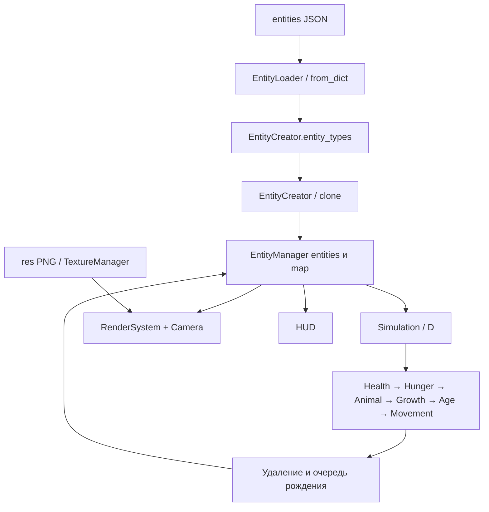

# Карта исходников и данных

## Как течёт состояние

`D.entities` и `D.map` — ссылки на коллекции менеджера. Удаление элементов существующего словаря видно системам; замена менеджером самого словаря оставит `D.entities` устаревшим. JSON — шаблоны, не сохранённый мир. `TextureManager` и `EntityCreator` имеют глобальные реестры класса.

## Корневые модули

| Файл | Ответственность и точки входа | Связи/важные ограничения |
|---|---|---|
| `main.py` | Загрузка ассетов/шаблонов, создание мира и окна, ввод, update, draw, завершение | Выполняет игру при импорте; нет main guard. Глобальные размер окна, tile size, turn delay. Импорт не годится для unit-тестов |
| `simulation.py` | `D` хранит зависимости, `Simulation.update()` накапливает время, `init_systems()` задаёт порядок | Clock.tick внутри симуляции; нет отдельного `step()`. BFS передан Animal, но не включён как общая фаза |
| `entity_manager.py` | Реестр компонентов, загрузка, клонирование, превращение, генерация карты, IDs, создание/удаление | Один файл содержит несколько ролей; генерация запускается в конструкторе |
| `camera.py` | Ввод WASD/колесо, zoom, преобразования координат; дополнительные follow/reset/view helpers | `world_to_screen` используется; обратное преобразование/view rect несовместимы с ним |
| `textures.py` | Загрузка PNG по stem и lookup; также `TileTextures` | Глобальные surfaces; две PNG загружаются уже при импорте. Нет преобразования под pixel format окна |
| `settings.json` | Пример карты 10×10 и количества сущностей | Не читается; не является действующей конфигурацией |
| `requirements.txt` | Текстовая просьба установить pygame | Некорректный pip-манифест |

### Роли в entity_manager.py

- `components`: имя JSON/ключ сущности → класс компонента. Новый компонент требует регистрации здесь и при необходимости экспорта из systems.
- `simple_components`: `id`, `type`, `state`; копируются отдельно от объектов компонентов.
- `EntityLoader.load_directory`: рекурсивный JSON-поиск, имя шаблона = имя файла без расширения. Ошибку печатает и продолжает. Неизвестные ключи игнорируются; одинаковые stem могут перезаписать шаблон.
- `EntityCreator.create_entity`: клонирует шаблон, задаёт Position. ID присваивается позже в менеджере.
- `_create_entity_from_template`: клонирует только зарегистрированные компоненты, Position задаёт аргументами (по умолчанию 0,0).
- `morth_target_to`: меняет type и компоненты шаблона, сохраняет существующие Age/Health/Hunger/Position; обновляет death texture. Старые отсутствующие в новом шаблоне компоненты не удаляет.
- `EntityManager.entities`: `dict[int, dict]`, содержит и тайлы, и организмы. `map` ссылается на те же tile dictionaries.
- `batch_spawn`: случайная попытка найти место с повторением до успеха; нет лимита попыток.
- `save_spawn_add` / `save_spawn_proccess`: очередь объектов, применение после систем. В снимке создаётся неиспользованный `new_entity`, а добавляется исходный объект очереди; позиция сохраняется, владение ссылками не изолировано.
- `delete_this_entity`: заменяет внутренний id на 0; `_delete_destroed_entities` затем удаляет по ключу словаря. Ссылки на объект/ID при этом не очищаются.
- `draw`: устаревший вызов RenderSystem с неправильным контрактом; основной цикл его не использует.
- `EntityMailman`: заготовка, метод `pass`, в игре не задействован.

## Компоненты, системы и поведения

| Модуль | Данные | Кто читает/меняет; роль |
|---|---|---|
| `systems/component_class.py` | Базовый Component | `from_dict` вызывает конструктор; `clone` копирует list/dict глубоко, остальные поля по ссылке. Не полная сериализация |
| `systems/position.py` | Position(x,y), hash/eq, distance | Координаты клеток; движение меняет объект. BFS использует Position как ключ — безопасно лишь пока он не изменён |
| `systems/health.py` | Health: HP, alive, death texture | HealthSystem фиксирует смерть; Hunger/Animal меняют HP; поведения читают alive |
| `systems/hunger.py` | Hunger: current/max satiety | HungerSystem расход/регенерация; поведения кормят; Movement расходует при блуждании |
| `systems/animal.py` | Animal: тип поведения, параметры жизни/детей, target_id, is_searching | AnimalSystem диспетчеризует поведение, проверяет возраст, превращает и ставит рождение в очередь |
| `systems/age.py` | Age: time/day/year, константы календаря | Age.update изменяет счётчики; AgeSystem вызывает для живых |
| `systems/plant.py` | Plant: зрелость, стадия, время, список текстур | GrowthSystem растит; Herbiovore сбрасывает после еды; требуется Renderable |
| `systems/tile.py` | Tile: тип, passable, fertillity, occupied | Проходимость читают движение/спавн/BFS. occupied не поддерживается, fertility хранится с опечаткой |
| `systems/path.py` | PathComp: destination, список Position | BFS получает координаты, возвращает bool; оба поведения вызывают поиск. destination — копия конечной клетки, clone копирует её независимо |
| `systems/movenent.py` | MoveComp: state/speed/force | MovementSystem исполняет состояния; MovementUtils содержит прежние помощники и предикат BFS/спавна |
| `systems/render.py` | Renderable: texture_name/layer | RenderSystem собирает/сортирует всех и масштабирует каждый sprite; читает Camera/TextureManager |
| `systems/behaviors/herbiovore.py` | Класс Herbiovore без ECS-компонента | Выбор зрелой еды, hungry/chill, еда, задание состояния движения и вызов BFS |
| `systems/behaviors/scavenger.py` | Класс Scavenger | Поиск пригодных трупов в радиусе 8, выбор доступного подхода ≤1; без еды — продолжаемый поисковый маршрут в случайном направлении |
| `systems/physics.py` | Только комментарии | Концепт скорости/массы, исполнения нет |
| `systems/__init__.py` | Публичные экспорты компонентов и систем | Используются wildcard imports и прямой импорт systems.__init__, усложняет зависимости |
| `systems/behaviors/__init__.py` | Экспорты двух поведений | Animal импортирует их через wildcard |

У `MoveComp.state` значения `stop`, `path`, `rand_move`. У верхнеуровневого `state` значения `chill`, `hungry`; это отдельное состояние поведения. Отсутствие пищевой цели — `Animal.target_id is None`. `Animal.is_searching` обозначает поисковый маршрут падальщика; верхнеуровневый state при поиске остаётся hungry. PathComp не хранит ID; `clear()` отменяет назначение и маршрут. Movement выполняет готовые шаги без чтения Animal и останавливается после последнего. Компонента `State`, используемого условно в HUD, в реестре нет.

## Интерфейс и ассеты

`find_path(entity, destination, max_distanse=10, arrival_distance=0)` возвращает True при построенном пути или уже достигнутой зоне. False очищает старые path/destination. `max_distanse=None` разрешает поиск по всей конечной карте. Для еды оба поведения задают arrival_distance=1; готовый маршрут переиспользуется, пока его конец остаётся в зоне выбранной пищи. Scavenger перебирает подходящие трупы по доступности; Herbiovore пока проверяет только ближайший куст. `reachable_positions(entity, max_distanse)` возвращает достижимые клетки внутри круга, не меняя PathComp; направление и назначение поиска выбирает поведение. Общая Pathfinding-фаза остаётся выключенной: поиск вызывается поведением при необходимости.

`interface/hud.py`: `HUD.draw` обходит `.values()`, рисует состояние, target из Animal, возраст, полосы животных и растений. `draw_stats` вызывает `_calculate_stats`, которая ошибочно обходит ключи словаря. `anim_values` хранит визуальные значения по Python `id(entity)` без очистки. Координаты HUD вычисляются без камеры.

| JSON | Компоненты/роль |
|---|---|
| `entities/sheep.json` | Position, Renderable, Health, Hunger, Animal herbivore, Age, PathComp, MoveComp; взрослый шаблон |
| `entities/baby_sheep.json` | Тот же набор, меньше HP/force, начальный возраст 0 |
| `entities/hyena.json` | Scavenger, увеличенная сытость и force; `baby_hyena` указан, но такого шаблона нет |
| `entities/bush.json` | Position, Renderable, Plant; незрелый куст |
| `entities/tiles/grass_tile.json` | Position, Renderable, Tile; проходимая трава |
| `entities/tiles/water_tile.json` | Position, Renderable, Tile; непроходимая вода |

`res/`: `grass.png`, `water.png`; `bush.png`, `berry_bush.png`; `sheep.png`, `baby_sheep.png`, `hyena.png`; `dead_sheep.png`, `dead_baby_sheep.png`, `dead_hyena.png`; `sheep_meat.png` (шаблона/механики отдельного мяса нет). Ключ текстуры = stem PNG.

Служебные каталоги: `.venv/` — локальное окружение; `__pycache__/` — кэш Python; `.vscode/` — локальные настройки редактора; `.git/` — история; `.gitignore` исключает окружение/кэш. Они не содержат правил игрового мира. [docs](README.md) — документация и аудит, не runtime-зависимость.

## Практическая карта изменений

| Задача | Начать с | Проверить рядом |
|---|---|---|
| Новый вид животного | JSON → Animal behavior registry | Текстуры, доступные adult/baby шаблоны, компоненты поведения |
| Новое поле компонента | Конструктор рядом с системой | JSON, from_dict, clone, критерии REQ |
| Доступность клетки | MovementUtils и MovementSystem | BFS, spawn, дети, трупы, несколько occupiers |
| Жизненный цикл | Simulation порядок, Animal, Health, Age | Морфинг/HP, очередь детей, удаление целей |
| Производительность | Render.draw, find_food, BFS neighbors | Измерения раздельно turn/render, нагрузочные миры |
| Клики/HUD | Camera и HUD | Клетки ↔ пиксели ↔ экран, roundtrip и zoom |
